# ПРОЦЕССЫ ПРОДАЖ (ФИНАЛЬНАЯ ВЕРСИЯ 2.0)

## 🔄 ИЗМЕНЕНИЯ ОТ ВЕРСИИ 1.0

### ❌ УДАЛЕНО:
1. **Процесс 3.2 и 3.3: Привязка устройства онлайн/оффлайн (мобильный продавец)** - удалены, так как у мобильных продавцов устройства привязываются автоматически при продаже
2. **Процесс 2.3: Редактирование профиля покупателя (хостес)** - удалено, хостес регистрируют один раз и не редактируют

### ✅ ДОБАВЛЕНО:
1. **Процесс 4.1: Регистрация пользователя (универсальный)** - универсальный процесс для всех ролей
2. **Процесс 4.2: Выбор торговой точки** - отдельный процесс, доступен в любой момент
3. **Процесс 2.3: Guided Trail (Презентация)** - упрощенный (только галочка: была/не была)
4. **Процесс 1.2: Справочник торговых точек** - с правами доступа, мягким удалением и картой
5. **Процесс 1.3: Аналитика** - карта с heat map и аналитикой по операциям
6. **Процесс 3.4: Редактирование профиля покупателя (мобильный)** - список всех пользователей с возможностью редактирования
7. **Процесс 4.4: Интеграция со сканером (опционально)** - для обсуждения
8. **Процесс 4.5: Интеграция с Halyk POS-терминалом (опционально)** - требует тестирования, **ждем по телефонам**
9. **Номер паспорта** - новое поле (ТОЛЬКО для не граждан РК)
10. **Продажа без регистрации** - backend автоматически использует "Джон Доу"
11. **Генерация пароля** - автоматическая генерация и отправка на email
12. **Координаты при привязке** - запоминание GPS координат
13. **Признак регистрации пользователя** - кто зарегистрировал (Хостес/Мобильные/Розница)
14. **Признак регистрации продавца у пользователя** - кто именно зарегистрировал этого пользователя
15. **Сброс пароля** - для текущих пользователей
16. **Логирование изменений** - кто отредактировал, что изменил
17. **Права доступа для хостес** - может редактировать только своих пользователей
18. **Guided Trail (расширенный)** - 3 этапа с лайками и опросниками

### 🔄 ИЗМЕНЕНО:
1. **Процесс 1.1: Создание хостес/мобильного продавца** - добавлена генерация пароля и отправка на email, логин = email, **добавлен сброс пароля**
2. **Процесс 1.2: Справочник торговых точек** - добавлено мягкое удаление, уникальность названия, визуализация карты
3. **Процесс 4.3: Авторизация** - убрано автоматическое разлогирование (из-за оффлайн режима)
4. **Процесс 2.1: Привязка устройства онлайн (хостес)** - изменено с "Продал/Не продал" на "Выдан подарок (Gift)"
5. **Процесс 2.2: Привязка устройства оффлайн (хостес)** - изменено с "Продал/Не продал" на "Выдан подарок (Gift)", добавлены GPS координаты
6. **Процесс 3.1: Продажа мобильным продавцом** - добавлена возможность продажи без регистрации
7. **Процесс 2.3 и 3.5: Guided Trail** - расширен до 3 этапов с лайками и опросниками
8. **Процесс 3.4: Редактирование профиля (мобильный)** - добавлена информация о том, кто зарегистрировал
9. **Процесс 4.1: Регистрация пользователя** - добавлен признак регистрации и регистрация через паспорт
10. **Все процессы** - используют универсальный процесс 4.1 для регистрации пользователей
11. **Все процессы** - отправка текущей выбранной торговой точки (выбирается через процесс 4.2)
12. **Все процессы** - логирование изменений

---

## ОБЩАЯ ИНФОРМАЦИЯ О МОБИЛЬНОМ ПРИЛОЖЕНИИ

**Технические детали:**
- Платформа: Flutter
- Публикация: App Store и Google Play Market
- Дизайн: Оптимизирован под планшеты
- Целевая аудитория: Хостес и мобильные продавцы

---

## ТАБЛИЦА ПРОЦЕССОВ

### 1. АДМИНКА

| № | Процесс | Описание | Статус | Реализовано |
|---|---------|----------|--------|-------------|
| 1.1 | **Создание хостес/мобильного продавца** | Создание пользователя с генерацией пароля и отправкой на email + сброс пароля | 🔄 ИЗМЕНЕН | ❌ |
| 1.2 | **Справочник торговых точек** | Управление точками с мягким удалением и картой | 🔄 ИЗМЕНЕН | ❌ |
| 1.3 | **Аналитика** | Карта с heat map и аналитикой по операциям | ✅ НОВЫЙ | ❌ |

### 2. ХОСТЕС

| № | Процесс | Описание | Статус | Реализовано |
|---|---------|----------|--------|-------------|
| 2.1 | **Привязка устройства онлайн** | Привязка устройства с интернетом | 🔄 ИЗМЕНЕН | ❌ |
| 2.2 | **Привязка устройства оффлайн** | Привязка устройства без интернета + GPS координаты | 🔄 ИЗМЕНЕН | ❌ |
| 2.3 | **Guided Trail (Презентация)** | Расширенная система: 3 этапа с лайками и опросниками | 🔄 ИЗМЕНЕН | ❌ |
| 2.4 | **Редактирование профиля покупателя** | Только своих пользователей | ✅ НОВЫЙ | ❌ |

### 3. МОБИЛЬНЫЙ ПРОДАВЕЦ

| № | Процесс | Описание | Статус | Реализовано |
|---|---------|----------|--------|-------------|
| 3.1 | **Продажа** | Мобильное приложение → Backend → 1С (только онлайн) | 🔄 ИЗМЕНЕН | ❌ |
| 3.2 | **Инкасация** | Отметка о внесении денег на счет компании | ⚪ БЕЗ ИЗМЕНЕНИЙ | ❌ |
| 3.3 | **Заявка на перемещение** | Заявка на перемещение товара со склада на склад продавца | ⚪ БЕЗ ИЗМЕНЕНИЙ | ❌ |
| 3.4 | **Редактирование профиля покупателя** | Список всех пользователей с информацией о регистрации | 🔄 ИЗМЕНЕН | ❌ |
| 3.5 | **Guided Trail (Презентация)** | Расширенная система: 3 этапа с лайками и опросниками | 🔄 ИЗМЕНЕН | ❌ |

### 4. ОБЩИЕ ПРОЦЕССЫ И ИНТЕГРАЦИИ

| № | Процесс | Описание | Статус | Реализовано |
|---|---------|----------|--------|-------------|
| 4.1 | **Регистрация пользователя (универсальный)** | Универсальный процесс + признак регистрации + регистрация через паспорт | 🔄 ИЗМЕНЕН | ❌ |
| 4.2 | **Выбор торговой точки** | Выбор текущей торговой точки (доступен в любой момент) | ✅ НОВЫЙ | ❌ |
| 4.3 | **Авторизация** | Авторизация хостес/мобильного продавца | 🔄 ИЗМЕНЕН | ❌ |
| 4.4 | **Интеграция со сканером (опционально)** | Интеграция с Bluetooth сканером для штрих-кодов/Data Matrix | ✅ НОВЫЙ (НА ОБСУЖДЕНИЕ) | ❌ |
| 4.5 | **Интеграция с Halyk POS-терминалом (опционально)** | Интеграция с POS-терминалом на мобильном телефоне | ✅ НОВЫЙ (ЖДЕМ ПО ТЕЛЕФОНАМ) | ❌ |

---

## 1. АДМИНКА

### 1.1. ПРОЦЕСС: СОЗДАНИЕ ХОСТЕС/МОБИЛЬНОГО ПРОДАВЦА
**🔄 ИЗМЕНЕН** - добавлена генерация пароля и отправка на email + сброс пароля

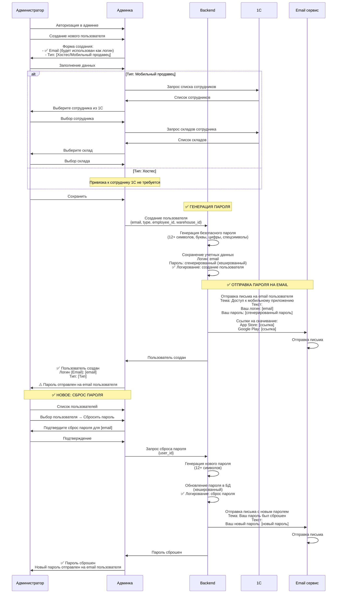

**Изменения:**
- ✅ **Логин = Email** пользователя
- ✅ **Автоматическая генерация пароля** (безопасный, 12+ символов)
- ✅ **Отправка пароля на email** (админ не видит пароль)
- ✅ **Письмо содержит:** логин, пароль, ссылки на скачивание приложения
- ✅ **Сброс пароля** - админ может сбросить пароль любому пользователю
- ✅ **Логирование** - создание пользователя и сброс пароля логируются

---

### 1.2. ПРОЦЕСС: СПРАВОЧНИК ТОРГОВЫХ ТОЧЕК
**🔄 ИЗМЕНЕН** - добавлено мягкое удаление, уникальность названия, визуализация карты

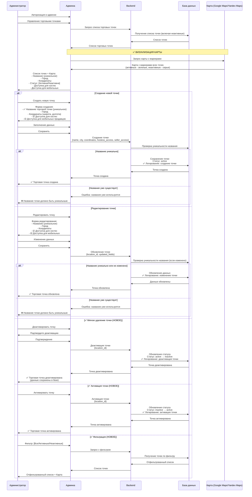

**Изменения:**
- ✅ **Мягкое удаление** - точки не удаляются из базы, а деактивируются (статус: active/inactive)
- ✅ **Уникальность названия** - название точки должно быть уникальным
- ✅ **Визуализация карты** - все точки отображаются на карте с маркерами
- ✅ **Цветовая индикация:** активные точки - зеленые, неактивные - серые
- ✅ **Фильтрация:** просмотр всех, только активных или только неактивных точек
- ✅ **Возможность активации** деактивированных точек
- ✅ **Логирование** - все действия с точками логируются

---

### 1.3. ПРОЦЕСС: АНАЛИТИКА
**✅ НОВЫЙ** - карта с heat map и аналитикой по операциям

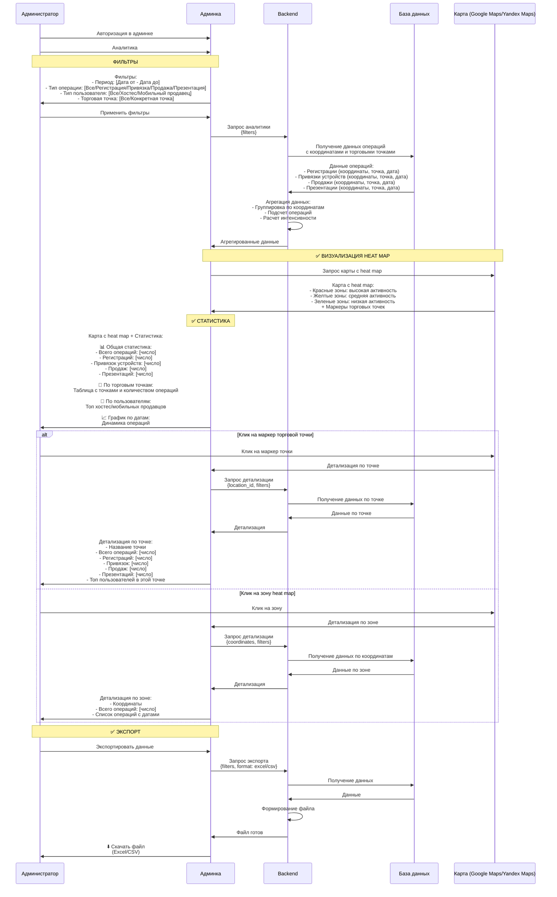

**Описание:**
- ✅ **Heat map** - визуализация интенсивности операций на карте
- ✅ **Фильтры:** период, тип операции, тип пользователя, торговая точка
- ✅ **Статистика:** общая, по точкам, по пользователям, график по датам
- ✅ **Детализация:** клик на маркер или зону для подробной информации
- ✅ **Экспорт:** выгрузка данных в Excel/CSV
- ✅ **Цветовая индикация:** красный (высокая активность), желтый (средняя), зеленый (низкая)

---

## 2. ХОСТЕС

### Особенности работы хостес

**Важно:**
- Хостес - это отдельное агентство (отдельная юр. компания)
- Закупают товар у нас B2B
- Принимают оплаты на свое юр. лицо
- **НЕТ фискализации** (не наша касса)
- **НЕТ создания документов продажи** в нашей 1С
- **НЕТ процесса продажи для хостес**
- **НЕТ информации о том, что продает хостес** - это не наше дело

**Хостес может:**
1. Регистрировать пользователей (см. процесс 4.1)
2. Привязывать устройства к пользователям (онлайн и оффлайн)
3. Отмечать выдачу подарка (Gift)
4. ✅ **Редактировать профиль покупателя** - только своих пользователей (процесс 2.4)
5. Проводить Guided Trail (Презентацию) - расширенная версия с лайками и опросниками
6. Выбирать торговую точку (см. процесс 4.2)

---

### 2.1. ПРОЦЕСС: ПРИВЯЗКА УСТРОЙСТВА ОНЛАЙН (ХОСТЕС)
**🔄 ИЗМЕНЕН** - изменено с "Продал/Не продал" на "Выдан подарок (Gift)"

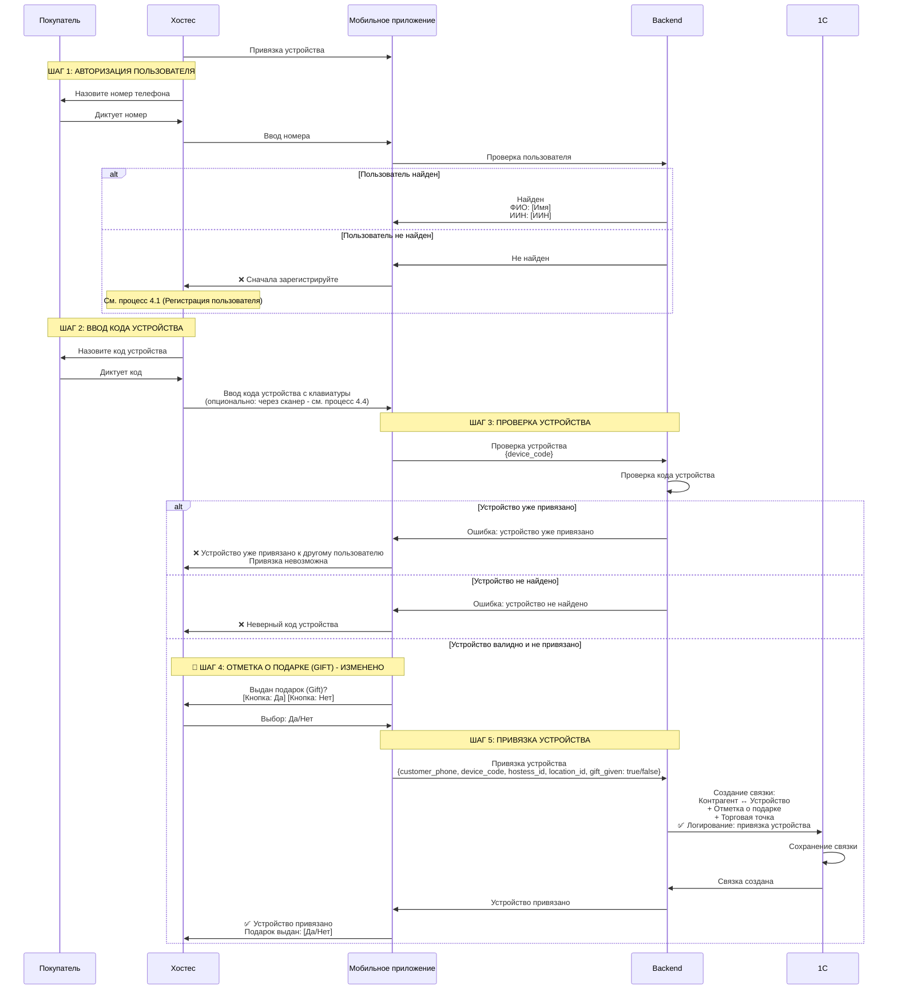

**Изменения:**
- 🔄 **Изменено с "Продал/Не продал" на "Выдан подарок (Gift)"**
- ✅ **Ввод кода устройства с клавиатуры** (сканер - отдельный опциональный процесс 4.4)
- ✅ **Отправка текущей выбранной торговой точки** (выбирается через процесс 4.2)
- ✅ **Логирование** - привязка устройства логируется

---

### 2.2. ПРОЦЕСС: ПРИВЯЗКА УСТРОЙСТВА ОФФЛАЙН (ХОСТЕС)
**🔄 ИЗМЕНЕН** - изменено с "Продал/Не продал" на "Выдан подарок (Gift)", добавлены GPS координаты

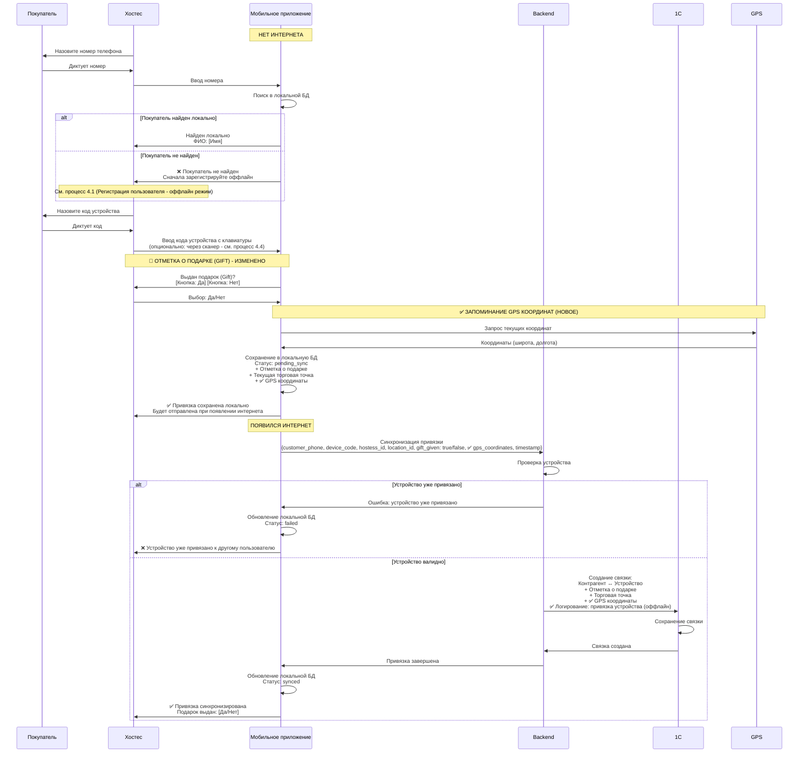

**Изменения:**
- 🔄 **Изменено с "Продал/Не продал" на "Выдан подарок (Gift)"**
- ✅ **Запоминание GPS координат** на момент привязки
- ✅ **Отправка GPS координат** вместе с данными привязки
- ✅ **Ввод кода устройства с клавиатуры** (сканер - отдельный опциональный процесс 4.4)
- ✅ **Отправка текущей выбранной торговой точки**
- ✅ **Логирование** - привязка устройства логируется (с пометкой оффлайн)

---

### 2.3. ПРОЦЕСС: GUIDED TRAIL (ПРЕЗЕНТАЦИЯ) - ХОСТЕС
**🔄 ИЗМЕНЕН** - расширенная система: 3 этапа с лайками и опросниками

```mermaid
sequenceDiagram
    participant Customer as Покупатель
    participant Hostess as Хостес
    participant App as Мобильное приложение
    participant Backend as Backend
    participant OneC as 1С

    Hostess->>App: Guided Trail
    
    Note over Hostess,Customer: ШАГ 1: АВТОРИЗАЦИЯ ПОКУПАТЕЛЯ
    Hostess->>Customer: Назовите номер телефона
    Customer->>Hostess: Диктует номер
    Hostess->>App: Ввод номера
    
    App->>Backend: Проверка покупателя
    
    alt Покупатель найден
        Backend->>App: Найден<br/>ФИО: [Имя]<br/>ИИН: [ИИН]
        
    else Покупатель не найден
        Backend->>App: Не найден
        App->>Hostess: ❌ Сначала зарегистрируйте
        Note over Hostess: См. процесс 4.1 (Регистрация пользователя)
    end
    
    Note over Hostess,App: ШАГ 2: ВЫБОР ТИПА GUIDED TRAIL
    App->>Hostess: Выберите тип:<br/>[Кнопка: Технический]<br/>[Кнопка: Полный]
    
    Hostess->>App: Выбор типа
    
    alt Тип: Технический
        Note over Hostess,App: ТЕХНИЧЕСКИЙ GUIDED TRAIL
        
        App->>Hostess: ✅ Презентация проведена?<br/>[Лайк: 👍] [Лайк: 👎]
        
        Hostess->>App: Выбор лайка (можно отжать)
        
        App->>Hostess: Чем завершился Guided Trail?<br/>[Кнопка: Продажа]<br/>[Кнопка: Отказ]
        
        Hostess->>App: Выбор результата
        
        alt Результат: Отказ
            App->>Hostess: Причины отказа (множественный выбор):<br/>☑️ Высокая цена<br/>☑️ Не понравился вкус<br/>☑️ Уже есть устройство<br/>☑️ Не интересно<br/>☑️ Другое: [Текст]
            
            Hostess->>App: Выбор причин
        end
        
        App->>Backend: Сохранение результата<br/>{customer_id, hostess_id, location_id,<br/>trail_type: "technical",<br/>presentation_like: true/false,<br/>result: "sale" | "rejection",<br/>rejection_reasons: [...]}
        
    else Тип: Полный
        Note over Hostess,App: ПОЛНЫЙ GUIDED TRAIL
        
        App->>Hostess: ✅ Презентация проведена?<br/>[Лайк: 👍] [Лайк: 👎]
        
        Hostess->>App: Выбор лайка (можно отжать)
        
        App->>Hostess: Какие стики были использованы? (Дегустация)<br/>☑️ Сигареты<br/>☑️ Системы нагревания<br/>☑️ Одноразки
        
        Hostess->>App: Выбор стиков (множественный)
        
        App->>Hostess: Чем завершился Guided Trail?<br/>[Кнопка: Продажа]<br/>[Кнопка: Отказ]
        
        Hostess->>App: Выбор результата
        
        alt Результат: Отказ
            App->>Hostess: Причины отказа (множественный выбор):<br/>☑️ Высокая цена<br/>☑️ Не понравился вкус<br/>☑️ Уже есть устройство<br/>☑️ Не интересно<br/>☑️ Другое: [Текст]
            
            Hostess->>App: Выбор причин
        end
        
        App->>Backend: Сохранение результата<br/>{customer_id, hostess_id, location_id,<br/>trail_type: "full",<br/>presentation_like: true/false,<br/>sticks_used: [...],<br/>result: "sale" | "rejection",<br/>rejection_reasons: [...]}
    end
    
    Note over Hostess,App: ШАГ 3: ПРОФИЛИРОВАНИЕ (ОПРОСНИК)
    App->>Hostess: [Кнопка: Открыть профилирование]
    
    Hostess->>App: Клик
    
    App->>Hostess: Модалка: Профилирование<br/><br/>Опросник (настраивается в админке):<br/>Вопросы с множественным выбором
    
    Hostess->>App: Заполнение опросника
    
    Hostess->>App: Сохранить
    
    App->>Backend: Сохранение профилирования<br/>{customer_id, hostess_id, location_id,<br/>questionnaire_id: "profiling",<br/>answers: {...}}
    
    Note over Hostess,App: ШАГ 4: ГИФТ
    App->>Hostess: ✅ Гифт выдан?<br/>[Лайк: 👍] [Лайк: 👎]
    
    Hostess->>App: Выбор лайка (можно отжать)
    
    App->>Backend: Сохранение гифта<br/>{customer_id, hostess_id, location_id,<br/>gift_given: true/false}
    
    Note over Hostess,App: ШАГ 5: ДРУГИЕ АКТИВНОСТИ
    App->>Hostess: [Кнопка: Другие активности]
    
    Hostess->>App: Клик
    
    App->>Hostess: Модалка: Другие активности<br/><br/>Список активностей (настраивается в админке):<br/>Лайки и опросники
    
    Hostess->>App: Выбор активности и заполнение
    
    App->>Backend: Сохранение активности<br/>{customer_id, hostess_id, location_id,<br/>activity_id: "...",<br/>data: {...}}
    
    Backend->>OneC: Создание записи:<br/>Guided Trail (полная)<br/>+ Все лайки<br/>+ Все опросники<br/>+ Торговая точка<br/>✅ Логирование: Guided Trail
    
    OneC->>Backend: Запись создана
    
    Backend->>App: Результат сохранен
    
    App->>Hostess: ✅ Guided Trail завершен
```

**Описание:**

**Типы Guided Trail:**
1. **Технический:**
   - Презентация (лайк)
   - Результат (Продажа/Отказ)
   - Причины отказа (если отказ)

2. **Полный:**
   - Презентация (лайк)
   - Дегустация стиков (множественный выбор): Сигареты, Системы нагревания, Одноразки
   - Результат (Продажа/Отказ)
   - Причины отказа (если отказ)

**Дополнительные блоки:**
- **Профилирование** - отдельная модалка с опросником (настраивается в админке)
- **Гифт** - лайк (выдан/не выдан)
- **Другие активности** - модалка со списком активностей (лайки + опросники, настраивается в админке)

**Система лайков:**
- Можно ставить 👍 (true) или 👎 (false)
- Можно отжать лайк (null)
- Лайки используются для быстрой оценки

**Опросники:**
- Множественный выбор
- Настраиваются в админке
- Используются для детальной аналитики

**Примечание:** Тест-драйв можно будет скрыть пока что

---

### 2.4. ПРОЦЕСС: РЕДАКТИРОВАНИЕ ПРОФИЛЯ ПОКУПАТЕЛЯ (ХОСТЕС)
**✅ НОВЫЙ** - только своих пользователей

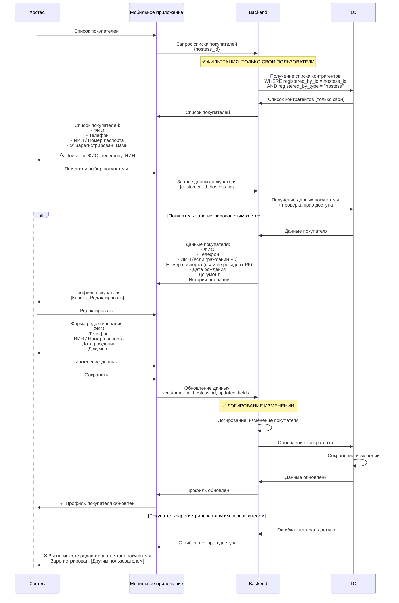

**Описание:**
- ✅ **Только свои пользователи** - хостес видит и может редактировать только тех, кого сам зарегистрировал
- ✅ **Проверка прав доступа** - backend проверяет registered_by_id и registered_by_type
- ✅ **Логирование** - все изменения записываются в логи
- ✅ **Отображение** - в списке видно, что пользователь зарегистрирован вами

---

## 3. МОБИЛЬНЫЙ ПРОДАВЕЦ

### Особенности работы мобильного продавца

**Важно:**
- **❌ НЕТ процессов привязки устройства** (3.2 и 3.3 удалены)
- **Причина:** У мобильных продавцов устройства привязываются **автоматически при продаже** (процесс 3.1, шаг 6)
- Не может быть случая, когда устройство не привязано - оно всегда привязывается в момент продажи

**Мобильный продавец может:**
1. Продавать товары (только онлайн) - **с автоматической привязкой устройства**
2. Регистрировать пользователей (см. процесс 4.1)
3. ❌ **НЕ МОЖЕТ привязывать устройства отдельно** - только через продажу
4. Делать инкасацию
5. Создавать заявки на перемещение товаров
6. Редактировать профиль покупателя (список всех пользователей)
7. Проводить Guided Trail (Презентацию) - расширенная версия с лайками и опросниками
8. Выбирать торговую точку (см. процесс 4.2)

---

### 3.1. ПРОЦЕСС: ПРОДАЖА (МОБИЛЬНЫЙ ПРОДАВЕЦ)
**🔄 ИЗМЕНЕН** - добавлена возможность продажи без регистрации

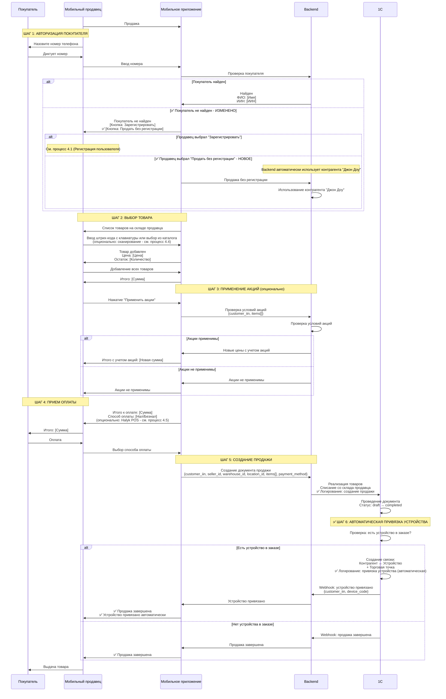

**Изменения:**
- ✅ **Добавлена кнопка "Продать без регистрации"** - backend автоматически использует контрагента "Джон Доу"
- ✅ **Автоматическая привязка устройства** при наличии в продаже
- ✅ **Ввод штрих-кода с клавиатуры** (сканер - отдельный опциональный процесс 4.4)
- ✅ **Отправка текущей выбранной торговой точки** (выбирается через процесс 4.2)
- ✅ **Опциональная интеграция с Halyk POS** (процесс 4.5)
- ✅ **Логирование** - создание продажи и привязка устройства логируются

**Важно:**
- ✅ **Устройства привязываются ТОЛЬКО через продажу** - отдельных процессов привязки нет
- ✅ **Привязка автоматическая** - продавец не выполняет дополнительных действий

---

### 3.2. ПРОЦЕСС: ИНКАСАЦИЯ (МОБИЛЬНЫЙ ПРОДАВЕЦ)
**⚪ БЕЗ ИЗМЕНЕНИЙ**

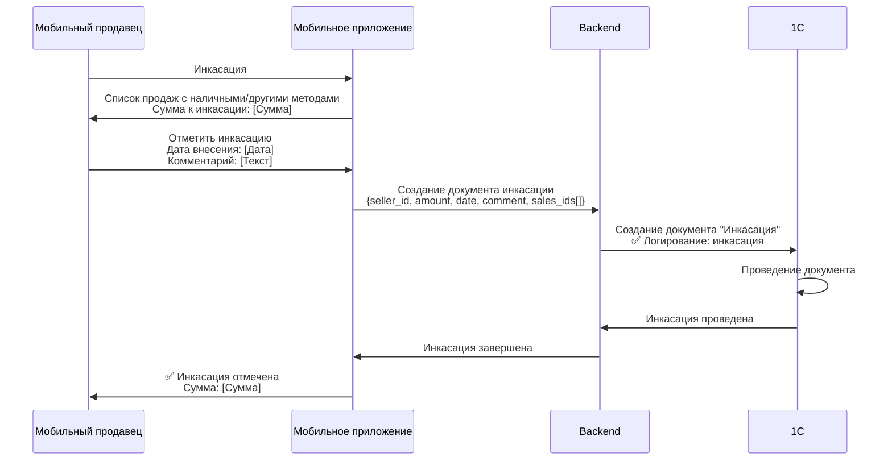

---

### 3.3. ПРОЦЕСС: ЗАЯВКА НА ПЕРЕМЕЩЕНИЕ (МОБИЛЬНЫЙ ПРОДАВЕЦ)
**⚪ БЕЗ ИЗМЕНЕНИЙ**

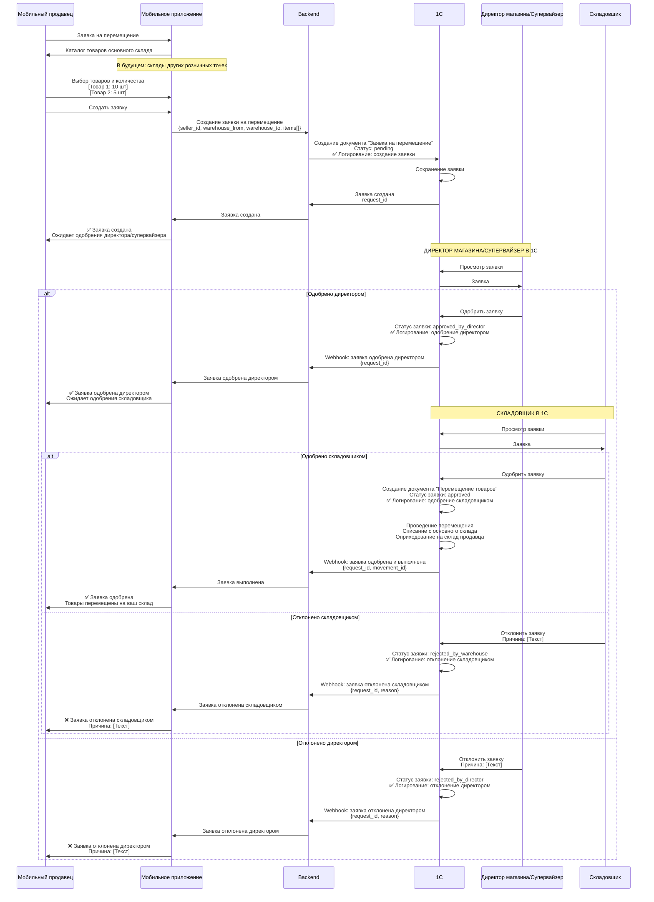

---

### 3.4. ПРОЦЕСС: РЕДАКТИРОВАНИЕ ПРОФИЛЯ ПОКУПАТЕЛЯ (МОБИЛЬНЫЙ ПРОДАВЕЦ)
**🔄 ИЗМЕНЕН** - добавлена информация о том, кто зарегистрировал

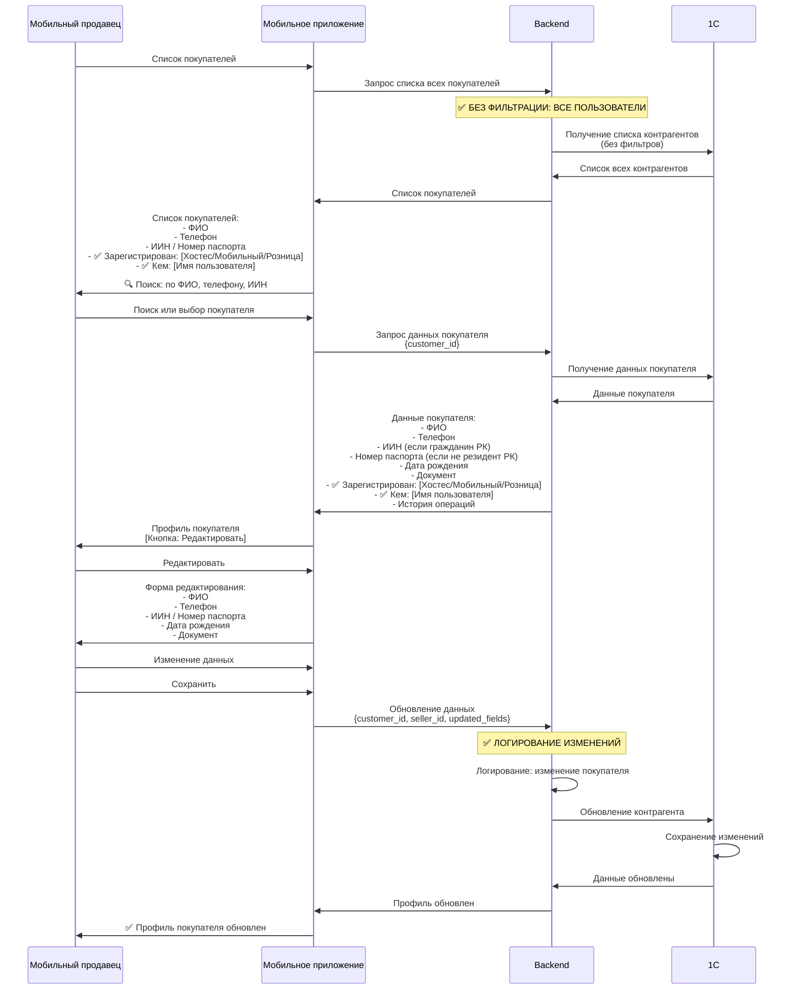

**Описание:**
- ✅ **Все пользователи** - мобильный продавец видит и может редактировать всех
- ✅ **Информация о регистрации:**
  - Кто зарегистрировал (Хостес/Мобильный/Розница)
  - Имя пользователя, который зарегистрировал
- ✅ **Логирование** - все изменения записываются в логи

---

### 3.5. ПРОЦЕСС: GUIDED TRAIL (ПРЕЗЕНТАЦИЯ) - МОБИЛЬНЫЙ ПРОДАВЕЦ
**🔄 ИЗМЕНЕН** - расширенная система: 3 этапа с лайками и опросниками

Аналогичен процессу 2.3 (Guided Trail - Хостес).
См. процесс 2.3 для подробностей.

---

## 4. ОБЩИЕ ПРОЦЕССЫ И ИНТЕГРАЦИИ

### 4.1. ПРОЦЕСС: РЕГИСТРАЦИЯ ПОЛЬЗОВАТЕЛЯ (УНИВЕРСАЛЬНЫЙ)
**🔄 ИЗМЕНЕН** - добавлен признак регистрации + регистрация через паспорт

**Описание:**
- **Универсальный процесс** для регистрации пользователей (используется всеми ролями)
- **Два режима:** онлайн (с OTP) и оффлайн (бумажная форма)
- **Два типа граждан:**
  - **Граждане РК:** ИИН (обязательно)
  - **Не граждане РК:** Номер паспорта (обязательно) + ФИО + Дата рождения + Документ
- **Номер паспорта** - уникальное поле в 1С (как ИИН)
- **Оффлайн режим:** сохранение в локальную БД с последующей синхронизацией
- **Проверка данных:** автоматическая проверка при синхронизации, создание задачи в Bitrix24 при ошибках
- **Онлайн режим:** OTP через SMS, ввод кода = согласие с пользовательским соглашением

**Новые поля:**
- ✅ **registered_by_type:** "hostess" | "seller" | "retail" - тип пользователя, который регистрирует
- ✅ **registered_by_id:** ID пользователя, который регистрирует
- ✅ **passport_number:** номер паспорта (для не граждан РК)

**Логика выбора типа гражданина:**
1. Пользователь выбирает: "Гражданин РК" или "Не резидент РК"
2. Если гражданин РК → поле ИИН (обязательно)
3. Если не резидент РК → поле Номер паспорта (обязательно)
4. Backend автоматически сохраняет:
   - `registered_by_type` - тип пользователя (hostess/seller/retail)
   - `registered_by_id` - ID пользователя, который регистрирует
5. ✅ **Логирование:** регистрация пользователя логируется

**Использование:**
- Этот процесс используется в:
  - Процессе 2.1, 2.2, 2.4 (хостес)
  - Процессе 3.1, 3.4 (мобильный продавец)
- Вместо дублирования кода просто ссылаемся: "См. процесс 4.1 (Регистрация пользователя)"

---

### 4.2. ПРОЦЕСС: ВЫБОР ТОРГОВОЙ ТОЧКИ
**✅ НОВЫЙ** - отдельный процесс, доступен в любой момент

**Описание:**
- **Отображение:** Текущая торговая точка отображается вверху экрана
- **Доступность:** Можно изменить в любой момент
- **Права доступа:** Список точек фильтруется по типу пользователя (хостес/мобильный)
- **Использование:** Все операции (регистрация, привязка, продажа) автоматически отправляют текущую выбранную точку

---

### 4.3. ПРОЦЕСС: АВТОРИЗАЦИЯ
**🔄 ИЗМЕНЕН** - убрано автоматическое разлогирование из-за оффлайн режима

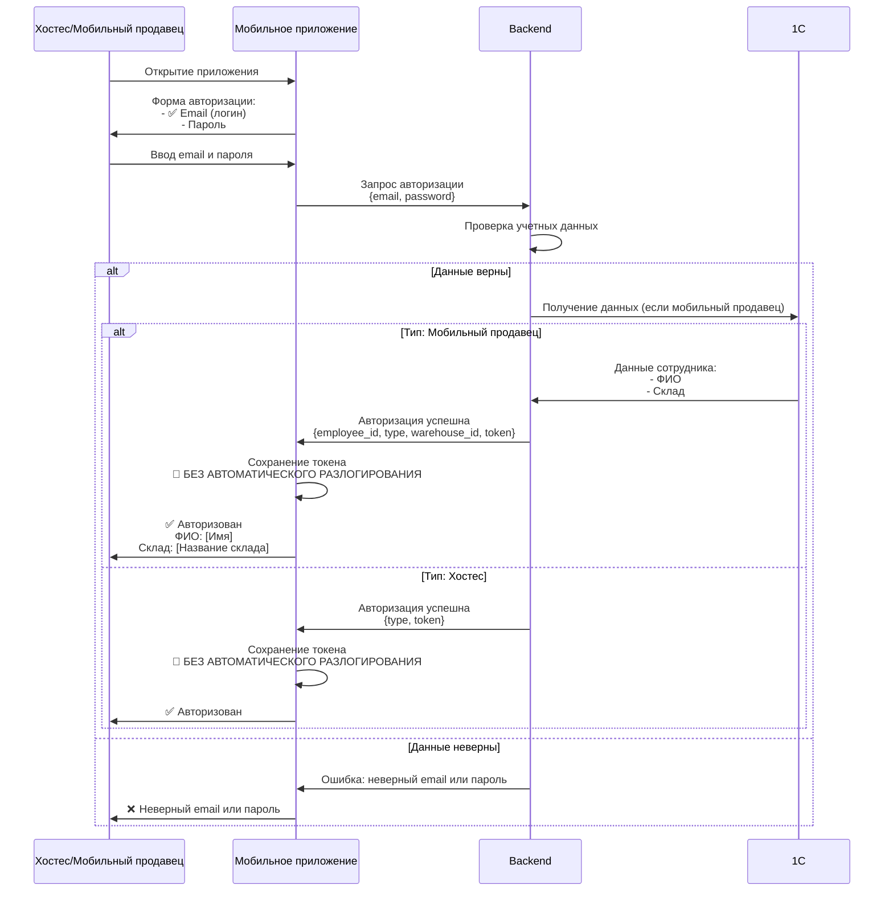

**Изменения:**
- 🔄 **Убрано автоматическое разлогирование** - токен сохраняется до ручного выхода
- **Причина:** Приложение поддерживает оффлайн режим, поэтому пользователь должен оставаться авторизованным для работы без интернета
- ✅ **Логин = Email** (изменено с обычного логина)

---

### 4.4. ПРОЦЕСС: ИНТЕГРАЦИЯ СО СКАНЕРОМ (ОПЦИОНАЛЬНО)
**✅ НОВЫЙ (НА ОБСУЖДЕНИЕ)**

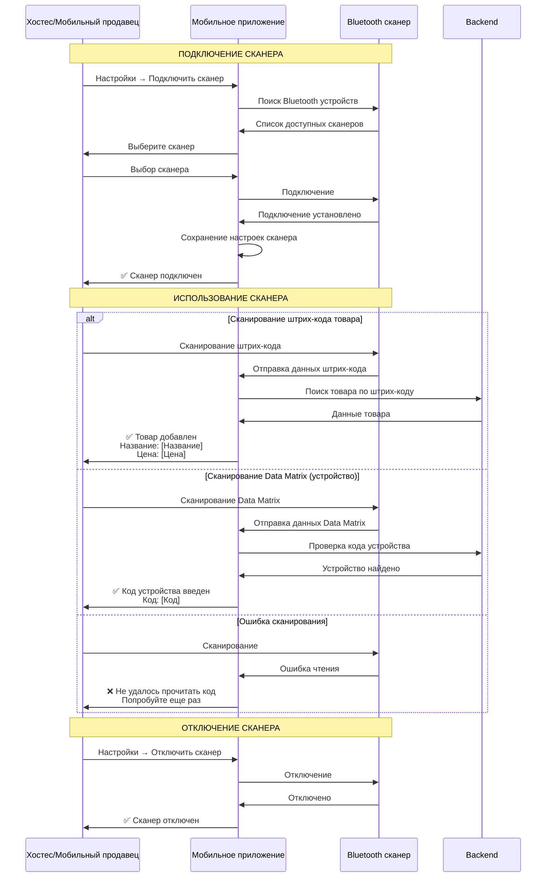

**Описание:**
- ✅ **Bluetooth сканер** - подключение через Bluetooth
- ✅ **Два типа кодов:** штрих-коды товаров и Data Matrix устройств
- ✅ **Автоматический ввод** - сканер автоматически вводит код в приложение
- ✅ **Настройки** - возможность подключить/отключить сканер
- ✅ **Обработка ошибок** - уведомление при ошибке сканирования

**Требует обсуждения:**
- Выбор модели сканера
- Тестирование совместимости
- Обработка различных форматов кодов

---

### 4.5. ПРОЦЕСС: ИНТЕГРАЦИЯ С HALYK POS-ТЕРМИНАЛОМ (ОПЦИОНАЛЬНО)
**✅ НОВЫЙ (ЖДЕМ ПО ТЕЛЕФОНАМ)**

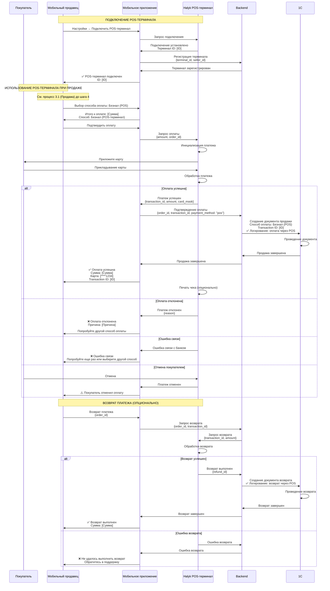

**Описание:**
- ✅ **Интеграция с Halyk POS** - прием безналичных платежей через мобильный POS-терминал
- ✅ **Автоматическая обработка** - платеж обрабатывается без ручного ввода
- ✅ **Сохранение данных** - transaction ID сохраняется в 1С
- ✅ **Возврат платежей** - возможность возврата через POS-терминал
- ✅ **Обработка ошибок** - уведомления при отклонении, ошибках связи, отмене
- ✅ **Логирование** - все операции с POS логируются

**Статус: ЖДЕМ ПО ТЕЛЕФОНАМ**

---

## ПРАВИЛА И ОСОБЕННОСТИ

### Мобильное приложение
- Платформа: Flutter
- Публикация: App Store и Google Play Market
- Дизайн: Оптимизирован под планшеты

### Создание пользователей (1.1)
- ✅ **Логин = Email** пользователя
- ✅ **Автоматическая генерация пароля** (безопасный, 12+ символов)
- ✅ **Отправка пароля на email** (админ не видит пароль)
- ✅ **Сброс пароля** - админ может сбросить пароль любому пользователю
- Типы: Хостес или Мобильный продавец
- Для мобильного продавца обязателен выбор сотрудника из 1С (сотрудник должен быть создан заранее)
- Для мобильного продавца обязательна привязка склада из 1С
- Для хостес привязка к сотруднику 1С не требуется

### Справочник торговых точек (1.2)
- ✅ **Мягкое удаление** - точки не удаляются из базы, а деактивируются
- ✅ **Уникальность названия** - название точки должно быть уникальным
- ✅ **Визуализация карты** - все точки отображаются на карте с маркерами
- ✅ **Фильтрация:** просмотр всех, только активных или только неактивных точек

### Аналитика (1.3)
- ✅ **Heat map** - визуализация интенсивности операций на карте
- ✅ **Фильтры:** период, тип операции, тип пользователя, торговая точка
- ✅ **Статистика:** общая, по точкам, по пользователям, график по датам
- ✅ **Экспорт:** выгрузка данных в Excel/CSV

### Логирование
- ✅ **Все изменения логируются:** кто, что, когда изменил
- ✅ **Логируются:** создание, изменение, удаление, деактивация всех сущностей
- ✅ **Просмотр в админке** с фильтрами

### Авторизация (4.3)
- ✅ **Логин = Email**
- Пароль (получен на email при создании)
- Получение данных из 1С (для мобильного продавца)
- Токен для дальнейшей работы
- 🔄 **БЕЗ автоматического разлогирования** (из-за оффлайн режима)

### Хостес (2.1 - 2.4)
- **НЕТ продаж** в нашей системе (отдельная юр. компания)
- **НЕТ информации о том, что продает хостес** - это не наше дело
- Только регистрация пользователей и привязка устройств
- Нет фискализации
- Нет документов продажи в нашей 1С
- Работа онлайн и оффлайн
- Может привязывать только непривязанные устройства
- При привязке устройства обязательна отметка о выдаче подарка (Gift)
- ✅ **Запоминание GPS координат** при оффлайн привязке
- ✅ **Может редактировать только своих пользователей** - тех, кого сам зарегистрировал
- Регистрация: см. процесс 4.1 (универсальный)
- Guided Trail: расширенная версия с лайками и опросниками

### Мобильный продавец (3.1 - 3.5)
- **Продажа ТОЛЬКО ОНЛАЙН** (без интернета продажа невозможна)
- ❌ **НЕТ процессов привязки устройства** (3.2 и 3.3 удалены)
- ✅ **Устройства привязываются АВТОМАТИЧЕСКИ при продаже** (процесс 3.1, шаг 6)
- Регистрация пользователей: см. процесс 4.1 (универсальный)
- Есть свой склад в 1С
- Возможность применения акций
- Инкасация денег
- Заявки на перемещение товаров
- ✅ **Редактирование всех пользователей** - без ограничений
- ✅ **Видит информацию о регистрации** - кто зарегистрировал пользователя
- ✅ **Продажа без регистрации** - backend автоматически использует контрагента "Джон Доу"
- Guided Trail: расширенная версия с лайками и опросниками

### Регистрация пользователя (4.1)
- **Универсальный процесс** для всех ролей
- **Два режима:** онлайн (с OTP) и оффлайн (бумажная форма)
- **Два типа граждан:**
  - Граждане РК: ИИН (обязательно)
  - Не граждане РК: Номер паспорта (обязательно) + ФИО + Дата рождения + Документ
- **Номер паспорта** - уникальное поле в 1С (как ИИН)
- **Оффлайн режим:** сохранение в локальную БД с последующей синхронизацией
- **Проверка данных:** автоматическая проверка при синхронизации, создание задачи в Bitrix24 при ошибках
- **Онлайн режим:** OTP через SMS, ввод кода = согласие с пользовательским соглашением
- ✅ **Признак регистрации:** registered_by_type и registered_by_id

### Выбор торговой точки (4.2)
- **Отображение:** Текущая торговая точка отображается вверху экрана
- **Доступность:** Можно изменить в любой момент
- **Права доступа:** Список точек фильтруется по типу пользователя (хостес/мобильный)
- **Использование:** Все операции автоматически отправляют текущую выбранную точку

### Интеграции (4.4, 4.5)
- **Сканер (4.4):** опционально, требует обсуждения и выбора модели
- **Halyk POS (4.5):** опционально, **ЖДЕМ ПО ТЕЛЕФОНАМ**

### Guided Trail (2.3, 3.5)
- **Два типа:** Технический и Полный
- **Технический:**
  - Презентация (лайк)
  - Результат (Продажа/Отказ)
  - Причины отказа (если отказ)
- **Полный:**
  - Презентация (лайк)
  - Дегустация стиков: Сигареты, Системы нагревания, Одноразки
  - Результат (Продажа/Отказ)
  - Причины отказа (если отказ)
- **Дополнительные блоки:**
  - Профилирование (опросник)
  - Гифт (лайк)
  - Другие активности (лайки + опросники)
- **Система лайков:** можно ставить/отжать
- **Опросники:** множественный выбор, настраиваются в админке

---

## ВОПРОСЫ ДЛЯ ОБСУЖДЕНИЯ

### 1. Интеграция со сканером (4.4)
- Какую модель Bluetooth сканера использовать?
- Нужна ли поддержка нескольких моделей?
- Как обрабатывать различные форматы кодов?

### 2. Интеграция с Halyk POS (4.5)
- **ЖДЕМ ПО ТЕЛЕФОНАМ**
- Доступен ли API Halyk POS для мобильных устройств?
- Какие модели POS-терминалов поддерживаются?
- Как обрабатывать возвраты и отмены?
- Нужна ли печать чеков?

### 3. Аналитика (1.3)
- Какие дополнительные метрики нужны?
- Нужны ли уведомления/алерты при аномалиях?
- Какие форматы экспорта предпочтительны?

### 4. Общие вопросы
- Нужна ли поддержка нескольких языков интерфейса?
- Какие дополнительные роли могут понадобиться в будущем?
- Нужна ли интеграция с другими платежными системами?

---

## ИТОГОВАЯ СТРУКТУРА ПРОЦЕССОВ

### 1. АДМИНКА (3 процесса)
- 1.1: Создание хостес/мобильного продавца (с генерацией пароля + сброс пароля)
- 1.2: Справочник торговых точек (с мягким удалением и картой)
- 1.3: Аналитика (heat map и статистика)

### 2. ХОСТЕС (4 процесса)
- 2.1: Привязка устройства онлайн
- 2.2: Привязка устройства оффлайн (с GPS координатами)
- 2.3: Guided Trail (расширенный с лайками и опросниками)
- 2.4: Редактирование профиля покупателя (только свои)

### 3. МОБИЛЬНЫЙ ПРОДАВЕЦ (5 процессов)
- 3.1: Продажа (с автоматической привязкой устройства)
- 3.2: Инкасация
- 3.3: Заявка на перемещение
- 3.4: Редактирование профиля покупателя (все пользователи)
- 3.5: Guided Trail (расширенный с лайками и опросниками)

### 4. ОБЩИЕ ПРОЦЕССЫ И ИНТЕГРАЦИИ (5 процессов)
- 4.1: Регистрация пользователя (универсальный + признак регистрации + паспорт)
- 4.2: Выбор торговой точки
- 4.3: Авторизация
- 4.4: Интеграция со сканером (опционально)
- 4.5: Интеграция с Halyk POS (опционально - ЖДЕМ ПО ТЕЛЕФОНАМ)

**Всего процессов: 17**

---

## КАРТОЧКА КЛИЕНТА

**Новый экран с блоками:**

1. **Профилирование**
   - Результаты опросника профилирования
   - История изменений

2. **Guided Trail**
   - История всех Guided Trail
   - Типы (Технический/Полный)
   - Результаты (Продажа/Отказ)
   - Лайки
   - Причины отказа

3. **Другие цикловые активности**
   - История всех активностей
   - Лайки
   - Результаты опросников

